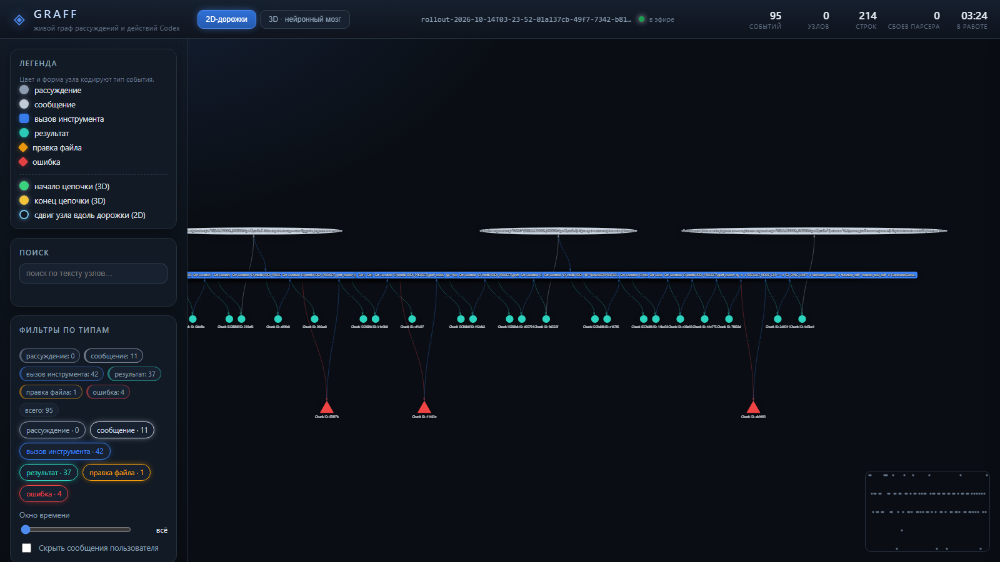
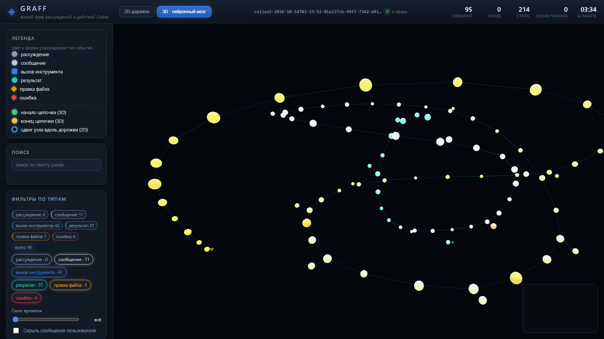
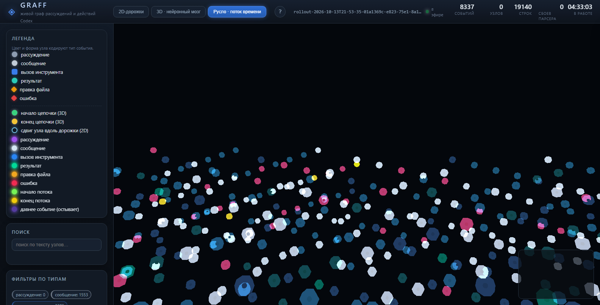
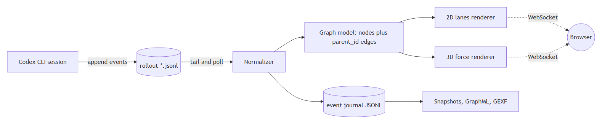
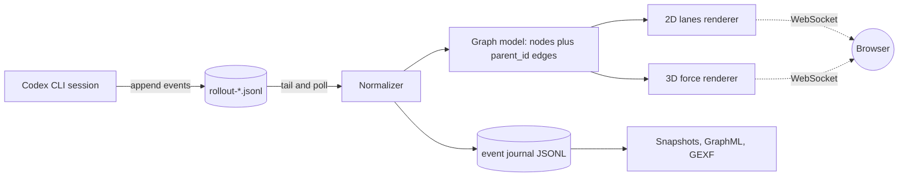
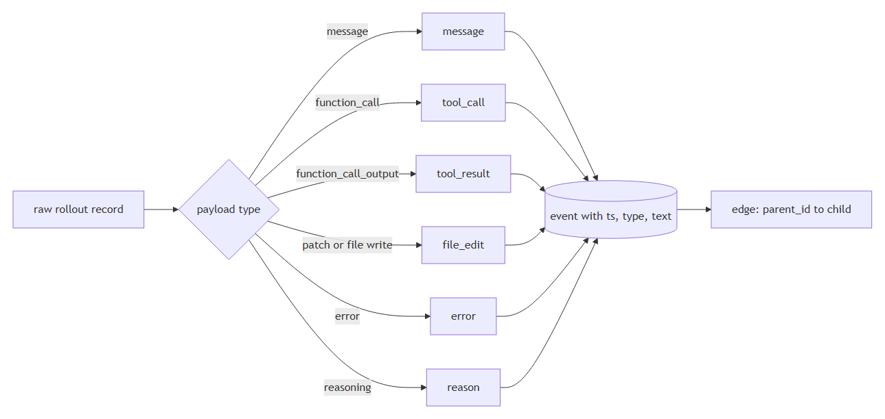
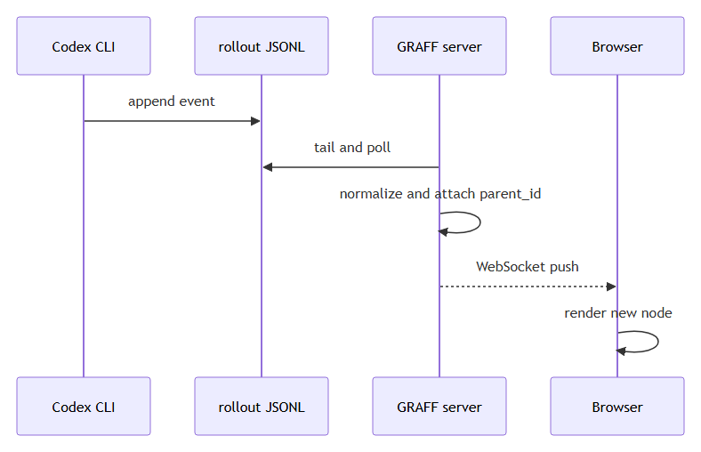

# GRAFF — a live lineage graph for an AI coding agent

[](README.md) [](README_ru.md)


**GRAFF turns the log of a coding agent into a live graph you can read.** Every reasoning step, tool call, file edit and error becomes a node; every causal link becomes an edge. The graph streams into the browser while the agent is still working, and every run can be saved, replayed and exported.

> Written from a data engineer's point of view: an agent is a pipeline, its session log is an append-only source, and what it really needs is lineage.

---

## Table of contents

- [Why this exists](#why-this-exists)
- [What you get](#what-you-get)
- [Architecture](#architecture)
- [Data model](#data-model)
- [Quick start](#quick-start)
- [Command line](#command-line)
- [Live mode and session selection](#live-mode-and-session-selection)
- [Optional AI enrichment](#optional-ai-enrichment)
- [Performance notes](#performance-notes)
- [Modes](#modes)
- [In-app help](#in-app-help)
- [Engineering log: what actually broke](#engineering-log-what-actually-broke)
- [Project layout](#project-layout)
- [Tests](#tests)
- [Documentation](#documentation)
- [Contacts](#contacts)

---

## Why this exists

Coding agents are used as black boxes. A run produces a diff, and the reasoning behind that diff disappears. As a data engineer I already have the right reflexes for this problem:

- **The source is a log.** Codex CLI writes one append-only JSONL file per session (`~/.codex/sessions/<YYYY>/<MM>/<DD>/rollout-*.jsonl`). No API, no connector, no schema migration: tail the file and you have a stream.
- **The log is a change feed.** Records arrive while work is happening, ordered, with a timestamp. That is a CDC source.
- **Reasoning has lineage.** Every tool call has a cause; every result has a parent. Once you store `parent_id`, a directed acyclic graph falls out of the data for free.
- **Observability beats trust.** A graph answers questions a diff cannot: where did the agent loop, which error sent it back, how much of the run was spent on one file.

GRAFF is that idea turned into a small Windows application: one parser, one socket, two renderers and a lot of deleted code.

## What you get

Three views of the same graph, because one is never enough.

**2D lanes** is the working view. Time runs left to right, event type is a horizontal lane, and arrows cross between lanes. It reads like a sequence diagram of the run: reasoning, terminal, file edits, and errors that throw the agent back. Nodes can be dragged along their lane to untangle long chains, and the offsets are remembered.

**3D neuron brain** is the shape view. The same nodes in three dimensions with a colour gradient over time, cold blue at the start of the session and warm orange at the end, slowly rotating. Green marker on the first node, yellow on the last, so a chain of thousands still has a visible beginning and end.

**River (stream of time)** is the view of the flow itself. The layout is not simulated, it is computed: time runs along the horizontal, branching spreads sideways (the parallel calls of one step), and layers recede into the depth. The ribbon snakes in bands, so a session of thousands of events never becomes one endless line. A node's position is fixed the moment it appears and never changes again -- new events only append at the tail, so movement on screen means time rather than a layout settling. Routine repeats fold into "xN" groups (on by default), a spark runs along every link from cause to effect, and fresh nodes flash as they arrive then slowly cool into a deep blue-violet. The picture is bright and cheap at the same time: every node is a saturated core plus a separate additive halo pass -- one extra draw call for the whole scene, never an object per node -- and links are camera-facing ribbons whose thickness is a real pixel width (a slider, default 3 px), because WebGL ignores `linewidth` and thin lines were why the edges were barely visible. The cost is paid only when something actually changes: instanced buffers carry dirty flags and are re-uploaded through a partial range, the frame loop allocates nothing, and node spheres are low-poly. When the scene goes quiet the loop parks itself on the last correct frame instead of spinning, and the diagnostics panel reports the result in numbers (frames per second, average and worst frame time, buffer re-uploads per second, idle gap, triangles, draw calls). The canvas is never left blank: opening `?mode=river` paints a real frame, every node gets its instance matrix written even if it is not being animated, a data update both paints and revives the render loop, and a forced `renderOnce()` outside a frame draws one on demand. The palette is saturated: reasoning purple, tool calls blue, results turquoise, file edits amber, errors red (red is reserved for errors), stream start green, stream end yellow. Cooling is measured against the session itself and anchored at the newest event, so the freshest node burns at full strength and the embers fade towards deep blue-violet as they age - never against the wall clock, so even an old session stays colourful. Broken data never leaves a black canvas: a dangling link (a folded group, a service node, an id left over from a previous session) is skipped and counted, a node id that looks like an Object.prototype key (`constructor`, `toString`) no longer resolves to an inherited function because every id map is null-prototype, and the whole scene build is wrapped so a record broken in some unanticipated way leaves the previous frame on screen and prints the reason to the journal, the dangling-link counter and the warning line show up in the diagnostics panel, and the failure itself lands in the application journal. The picture can be checked without eyes: the «Self-check» button (or `GRAFF.river.selfCheck()`) renders a frame, reads the pixels back and returns numbers -- non-black pixels, distinct hues, a line signature and how many nodes made it into the frame. The additive halo pass is gated by the same dirty flags and is not re-uploaded for nothing. Shaders are verified rather than assumed to work: the custom halo layer no longer reads vColor without a guard (an undeclared vColor invalidated the whole program and left the canvas black while every counter looked healthy), three's shader-error checking is switched on explicitly, the live program list is inspected after the first draw, and the driver's message lands in the application journal and in a dedicated "shaders" diagnostic row. The pixel self-check is now honest: if a program failed to compile or the frame came back empty it returns supported: false with a plain-language reason instead of bare zeroes.







All three views share the same filters by event type, text search, time window, click-through details panel, ancestor/descendant path highlighting, and export to JSON, GraphML and GEXF.

## Architecture





**Normalize at the edge.** Raw rollout records mix session metadata, world state, turn context, token counters, messages and tool traffic. Exactly one small schema is produced from them, and every consumer downstream reads only that.



**Stream, do not poll the UI.** The server tails the session file and pushes deltas over a WebSocket, so the graph grows while the agent is still typing.



## Data model

| Field | Meaning |
|---|---|
| `ts` | event time (UTC, taken from the record) |
| `actor` | `codex`, `user` or `rowboat` |
| `type` | `reason`, `message`, `tool_call`, `tool_result`, `file_edit`, `error` |
| `text` | human readable payload, truncated for the UI |
| `parent_id` | the event that caused this one, which is what makes it a DAG |

A turn with one thought and five tool calls is a real branch, and it looks like one instead of a flat list.

## Quick start

### From source

```cmd
git clone https://github.com/sergeyh510-alt/GRAFF-CODEX.git
cd GRAFF-CODEX
python -m pip install -r requirements.txt
python run.py --open
```

The interface opens at http://127.0.0.1:8756 and follows the newest session that actually contains work. Python 3.10 or newer; no virtual environment required.

### As a single executable

```cmd
python -m pip install pyinstaller
python build.py
```

The result is `dist\GRAFF.exe`, about 30 MB, working as a standalone file: it starts a local server, opens the browser and keeps its mutable state (event journal, snapshots, exports, remembered session) in a `runtime` folder next to the executable. Static assets are bundled and resolved through `sys._MEIPASS`, so the executable does not need the project folder.

## Command line

| Flag | Purpose |
|---|---|
| `--session latest` | newest session with real content (empty sessions are skipped) |
| `--session index:3` | session by row number from `--list-sessions` |
| `--session <path>` | explicit `rollout-*.jsonl` file |
| `--list-sessions` | table of recent sessions: time, size, tool calls, events |
| `--port`, `--host` | bind address, default `127.0.0.1:8756` |
| `--sessions-root` | where Codex keeps its sessions |
| `--node-cap` | maximum nodes sent to the browser |
| `--runtime` | folder for journal, snapshots and state |
| `--poll` | session polling interval in seconds |
| `--backend auto\|fastapi\|stdlib` | web backend, standard library fallback included |
| `--enrich` | optional AI summaries, see below |
| `--demo` | synthetic session for trying the UI out |
| `--open` | open the browser on start |

## Live mode and session selection

Sessions are selected with a clear precedence: `--session` argument, then the remembered session in `runtime/state.json`, then the newest session that contains work. The interface has a session list (time, nodes, tool calls, active marker) and a **follow new sessions** switch: with it on, a new chat is picked up automatically; with it off, the current one stays pinned. Switching happens over `POST /api/session` without restarting the server.

## Optional AI enrichment

With this provider stack the model does not return reasoning summaries, so the `reason` nodes would stay empty. Enrichment mode fills them: a short summary is requested for each assistant step and attached as the parent of its tool calls, cached by hash so a second run costs nothing.

```cmd
set ROUTERAI_API_KEY=your-key-here
python run.py --enrich
```

**No keys live in this repository.** The key is read from the environment only (`ROUTERAI_API_KEY` or `AITUNNEL_API_KEY`), the endpoint from `ROUTERAI_BASE_URL` / `AITUNNEL_BASE_URL`, the model from `GRAFF_LLM_MODEL`. Nothing is written to config files, and the `.gitignore` keeps runtime output out of the repository.

## Performance notes

Early versions were unusable on real sessions. Measured, not guessed:

| Situation | Before | After |
|---|---|---|
| Opening a 12.5 MB session | 57.7 s (quadratic re-splitting of the buffer) | 0.56 s |
| 3D scene, about 3900 nodes | 11 381 draw calls, CPU 67 percent while the GPU idled at 28 percent | 2 951 draw calls, about 7.8x less CPU per frame |

The 3D fixes were structural rather than cosmetic: links are drawn as one line primitive instead of a tube per edge, nodes use instancing instead of a mesh per node, glow sprites only appear below a few hundred nodes, tooltip DOM is off, physics stops once the layout settles, and rendering pauses on a hidden tab.

## Engineering log: what actually broke

The most useful table in this repository. Every row happened during development on real sessions.

| Symptom | Real cause | Fix |
|---|---|---|
| Graph opens empty | "latest session" was the newest file, a 27 line session with no tool calls | Select the newest session with content (1 node became 403) |
| Library refuses to load | The Windows registry maps `.js` to `text/plain` and Python's `mimetypes` honours it, so scripts were served as text | Own MIME table, `no-store`, `nosniff`, versioned URLs |
| Error overlay always covered the graph | Our own CSS `display: grid` beat the `hidden` attribute | `[hidden] { display: none !important; }` |
| "Your fix changed nothing" | An old server process kept serving the previous static files from memory | Restart the process, not just edit the file |
| 3D unusable at scale | Per-edge and per-node objects, thousands of draw calls | Lines for edges, instancing for nodes |
| 3D library crashed on load | It needs `THREE.Timer`, which does not exist in the pinned three release, and the shim returned nothing from `update()` while the library chained `update().getDelta()` | Shim the API contract exactly, including return values |
| Two 2D modes looked identical | The floating layout branch checked a value the layout selector could never produce | One source of truth for the active mode |

Lessons, in data engineering language: freshness is not usefulness; when a GPU idles while the CPU spins, count your objects, not your pixels; normalize at the edge; save structures, not screenshots.

## Project layout

```
graff/               server and domain logic
  rollout.py         tail, parse and normalize Codex rollouts
  graph.py           event to node and edge model
  engine.py          incremental session processing
  state.py           session selection and persistence
  store.py           event journal and graph snapshots
  api.py             transport independent API surface
  server_fastapi.py  FastAPI and WebSocket server
  server_stdlib.py   dependency free fallback server
  static_files.py    static serving with an explicit MIME table
  enrich.py          optional AI summaries
  ws.py, hub.py      WebSocket plumbing
static/              frontend: index.html, css, app.js, boot.js, river.js, vendored libs
scripts/             helper tools (demo session, diagram rendering, asset fetch)
tools/md_to_docx.py  markdown to docx converter used for the article
tests/               end to end checks against a real rollout
docs/                article, figures, screenshots
run.py               entry point
build.py             PyInstaller build, produces dist/GRAFF.exe
```

## Modes

The tabs in the header switch the view; the chosen mode is remembered and restored on the next open. It can also be set from the address: `?mode=2d`, `?mode=3d`, `?mode=river`.

| Mode | What it shows | Layout | Notes |
|---|---|---|---|
| 2D lanes | the sequence | lanes (time x type), hierarchy L->R / T->B, free physics | drag a node along its lane |
| 3D neural brain | the shape of long chains | 3d-force-graph forces | colour by time, start/end markers |
| River (stream of time) | the flow of time itself | a computed formula, no physics | "xN" groups, sparks along links, cooling |

## In-app help

A **"?"** button in the header, next to the view switcher, opens the About dialog: what the app is, the author, contacts and the license. It closes with the × button, `Esc` or a click on the dimmed backdrop. The dialog makes no external requests and uses no trackers, and every link opens in a new tab only when clicked. The version shown comes from the same source as `/api/status` (i.e. `graff.__version__`) and is never duplicated in the markup.

The dialog can be opened straight from the URL, without any clicking: `http://127.0.0.1:8756/?about=1`.

## Tests

```cmd
python -m unittest discover -s tests -v
```

128 checks covering the parser against a real rollout, session selection, session persistence, the API surface, static file MIME handling, the frontend wiring, the rendering modes, the pixel self-check of the river view, the null-prototype identity maps, the atomic scene build and the About dialog. All green.

## Documentation

- [`docs/linkedin-article-en.md`](docs/linkedin-article-en.md) and [`docs/linkedin-article-ru.md`](docs/linkedin-article-ru.md): the story behind the project, written for data engineers
- `docs/GRAFF_LinkedIn_EN.docx` and `docs/GRAFF_LinkedIn_RU.docx`: the same article as documents, diagrams included
- `docs/figures/`: source diagrams, regenerated with `python scripts/mermaid_local.py docs/linkedin-article-en.md`

## Contacts

**Sergey Chekryzhov**

- Email: sergeyh510@gmail.com
- GitHub: [sergeyh510-alt](https://github.com/sergeyh510-alt)
- Project: https://github.com/sergeyh510-alt/GRAFF-CODEX
- LinkedIn: [sergey-chekryzhov](https://www.linkedin.com/in/sergey-chekryzhov-a38778217)
- Telegram: [@SergeyChekryzhov](https://t.me/SergeyChekryzhov)

This project is distributed under the MIT License, see the [LICENSE](LICENSE) file for details.

---

Built with Python, FastAPI, vis-network, three.js and 3d-force-graph. No API keys, no telemetry, no cloud: everything runs locally.
