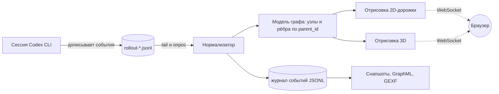

# GRAFF — живой граф рассуждений ИИ-агента, который пишет код

[](README.md) [](README_ru.md)


**GRAFF превращает лог пишущего код агента в живой граф, который можно читать.** Каждый шаг рассуждения, вызов инструмента, правка файла и ошибка становятся узлами, каждая причинная связь становится ребром. Граф приходит в браузер, пока агент ещё работает, а любой запуск можно сохранить, проиграть и выгрузить.

> Написано с позиции дата-инженера: агент это конвейер, его лог это дописываемый источник, а нужен ему на самом деле lineage.

---

## Оглавление

- [Зачем это нужно](#зачем-это-нужно)
- [Что вы получаете](#что-вы-получаете)
- [Архитектура](#архитектура)
- [Модель данных](#модель-данных)
- [Быстрый старт](#быстрый-старт)
- [Командная строка](#командная-строка)
- [Живой режим и выбор сессии](#живой-режим-и-выбор-сессии)
- [Необязательное ИИ-обогащение](#необязательное-ии-обогащение)
- [Производительность](#производительность)
- [Режимы](#режимы)
- [Справка о программе](#справка-о-программе)
- [Журнал разработки: что реально ломалось](#журнал-разработки-что-реально-ломалось)
- [Структура проекта](#структура-проекта)
- [Тесты](#тесты)
- [Документация](#документация)
- [Контакты](#контакты)

---

## Зачем это нужно

Агентами для написания кода пользуются как чёрным ящиком. Запуск даёт дифф, а рассуждения, которые к нему привели, исчезают. У дата-инженера на такую задачу уже есть готовые рефлексы:

- **Источник это лог.** Codex CLI пишет по одному дописываемому JSONL-файлу на сессию (`~/.codex/sessions/<ГГГГ>/<ММ>/<ДД>/rollout-*.jsonl`). Ни API, ни коннектора, ни миграций схем: следим за файлом и получаем поток.
- **Лог это поток изменений.** Записи приходят по мере работы, по порядку, со временем. Это источник в духе CDC.
- **У рассуждений есть происхождение.** У каждого вызова есть причина, у каждого результата есть родитель. Достаточно хранить `parent_id`, и направленный ациклический граф получается из данных сам.
- **Наблюдаемость важнее доверия.** Граф отвечает на вопросы, на которые дифф не отвечает: где агент зациклился, какая ошибка отбросила его назад, сколько запуска ушло на один файл.

GRAFF и есть эта мысль, превращённая в небольшое приложение для Windows: один парсер, один сокет, две отрисовки и много удалённого кода.

## Что вы получаете

Три вида одного графа, потому что одного всегда мало.

**2D-дорожки** это рабочий вид. Время идёт слева направо, тип события это горизонтальная дорожка, стрелки идут между дорожками. Читается как диаграмма последовательности: рассуждение, терминал, правки файлов и ошибки, которые отбрасывают агента назад. Узлы можно тянуть вдоль своей дорожки, чтобы распутать длинные цепочки, и сдвиги запоминаются.

**3D «нейронный мозг»** это вид формы. Те же узлы в трёх измерениях с градиентом по времени: холодный синий в начале сессии, тёплый оранжевый в конце, медленное вращение. Зелёная метка на первом узле, жёлтая на последнем, поэтому у цепочки на тысячи узлов всё равно видно начало и конец.

**«Русло · поток времени»** это вид самого потока. Раскладка не считается силами, а вычисляется формулой: по горизонтали время, в стороны расходится ветвление (параллельные вызовы одного шага), в глубину уходят слои. Лента сворачивается змейкой, поэтому сессия на тысячи событий не превращается в бесконечную линию. Позиция узла фиксируется в момент появления и больше не меняется — новые события только дописываются в конец, так что движение на экране означает время, а не подгонку раскладки. Рутинные повторы сворачиваются в группы «×N» (по умолчанию включено), по связи от причины к следствию пробегает искра, свежие узлы вспыхивают при появлении и постепенно остывают в глубокий сине-фиолетовый. Холст никогда не остаётся чёрным: открытие `?mode=river` сразу рисует настоящий кадр, матрица каждого узла записывается в сцену, даже если он не анимируется, обновление данных и рисует кадр, и возвращает цикл отрисовки к жизни, а когда анимировать больше нечего, цикл переходит на редкий тик вместо полной остановки. Палитра сочная: рассуждение фиолетовое, вызов синий, результат бирюзовый, правка янтарная, ошибка красная (красный закреплён только за ошибками), начало потока зелёное, конец жёлтый.


Во всех трёх видах одни и те же фильтры по типам, поиск по тексту, окно времени, панель деталей по клику, подсветка пути от предков к потомкам и экспорт в JSON, GraphML и GEXF. Лимиты тоже общие: в 3D сцена ограничена по числу узлов, в «Русле» — 4000, а тяжёлые связи и спрайты включаются только для небольших графов.

## Архитектура




**Нормализация на входе.** Сырые записи роллаута смешивают метаданные сессии, состояние мира, контекст хода, счётчики токенов, сообщения и трафик инструментов. Из них получается ровно одна маленькая схема, и все потребители дальше читают только её.


**Поток вместо опроса интерфейса.** Сервер следит за файлом сессии и отправляет изменения по WebSocket, поэтому граф растёт, пока агент ещё печатает.


## Модель данных

| Поле | Смысл |
|---|---|
| `ts` | время события (UTC, берётся из записи) |
| `actor` | `codex`, `user` или `rowboat` |
| `type` | `reason`, `message`, `tool_call`, `tool_result`, `file_edit`, `error` |
| `text` | текст для человека, обрезается для интерфейса |
| `parent_id` | событие, которое вызвало это, именно оно делает граф ациклическим |

Ход с одной мыслью и пятью вызовами инструментов это настоящее ветвление, и выглядит оно как ветвление, а не как плоский список.

## Быстрый старт

### Из исходников

```cmd
git clone https://github.com/sergeyh510-alt/GRAFF-CODEX.git
cd GRAFF-CODEX
python -m pip install -r requirements.txt
python run.py --open
```

Интерфейс открывается на http://127.0.0.1:8756 и следит за самой свежей сессией, в которой действительно есть работа. Нужен Python 3.10 или новее, виртуальное окружение не обязательно.

### Одним файлом

```cmd
python -m pip install pyinstaller
python build.py
```

На выходе `dist\GRAFF.exe` примерно на 30 МБ, работающий как самостоятельный файл: он поднимает локальный сервер, открывает браузер и держит изменяемое состояние (журнал событий, снапшоты, экспорты, запомненную сессию) в папке `runtime` рядом с собой. Статика упакована внутрь и находится через `sys._MEIPASS`, поэтому папка проекта exe не нужна.

## Командная строка

| Флаг | Назначение |
|---|---|
| `--session latest` | самая свежая сессия с реальным содержимым (пустые пропускаются) |
| `--session index:3` | сессия по номеру строки из `--list-sessions` |
| `--session <путь>` | явный файл `rollout-*.jsonl` |
| `--list-sessions` | таблица последних сессий: время, размер, вызовы инструментов, события |
| `--port`, `--host` | адрес и порт, по умолчанию `127.0.0.1:8756` |
| `--sessions-root` | где лежат сессии Codex |
| `--node-cap` | предел числа узлов, отправляемых в браузер |
| `--runtime` | папка для журнала, снапшотов и состояния |
| `--poll` | период опроса файла сессии в секундах |
| `--backend auto\|fastapi\|stdlib` | веб-бэкенд, есть запасной на стандартной библиотеке |
| `--enrich` | необязательные ИИ-резюме, см. ниже |
| `--demo` | синтетическая сессия, чтобы посмотреть интерфейс без данных |
| `--open` | открыть браузер при запуске |

## Живой режим и выбор сессии

Сессия выбирается по понятному приоритету: аргумент `--session`, затем запомненная сессия в `runtime/state.json`, затем самая свежая сессия с работой. В интерфейсе есть список сессий (время, узлы, вызовы инструментов, метка активной) и переключатель **«следить за новыми сессиями»**: при включённом новое окно чата подхватывается само, при выключенном текущая остаётся закреплённой. Переключение идёт через `POST /api/session` без перезапуска сервера.

## Необязательное ИИ-обогащение

С этим набором провайдеров модель не возвращает сводки рассуждений, поэтому узлы `reason` остались бы пустыми. Режим обогащения их заполняет: для каждого шага ассистента запрашивается короткое резюме и подставляется родителем его вызовов инструментов, с кэшем по хешу, поэтому повторный прогон ничего не стоит.

```cmd
set ROUTERAI_API_KEY=ваш-ключ
python run.py --enrich
```

**В этом репозитории нет ключей.** Ключ читается только из переменной окружения (`ROUTERAI_API_KEY` или `AITUNNEL_API_KEY`), адрес из `ROUTERAI_BASE_URL` / `AITUNNEL_BASE_URL`, модель из `GRAFF_LLM_MODEL`. В файлы настроек ничего не пишется, а `.gitignore` не пускает в репозиторий результаты работы в `runtime`.

## Производительность

Первые версии на реальных сессиях были неработоспособны. Всё измерено, а не угадано:

| Ситуация | Было | Стало |
|---|---|---|
| Открытие сессии 12,5 МБ | 57,7 с (квадратичное разбиение буфера) | 0,56 с |
| Сцена 3D, около 3900 узлов | 11 381 draw call, процессор 67 процентов при GPU 28 | 2 951 draw call, процессора на кадр меньше примерно в 7,8 раза |

Правки в 3D были структурными, а не косметическими: связи рисуются одной линией вместо трубы на каждое ребро, узлы через инстансинг вместо меша на каждый узел, спрайты свечения включаются только ниже нескольких сотен узлов, подсказки в DOM отключены, физика останавливается после стабилизации раскладки, а отрисовка замирает на скрытой вкладке.

## Журнал разработки: что реально ломалось

Самая полезная таблица в репозитории. Все строки случились в разработке на настоящих сессиях.

| Симптом | Настоящая причина | Исправление |
|---|---|---|
| Граф открывается пустым | «Последняя сессия» оказывалась самым свежим файлом, а это была сессия на 27 строк без вызовов инструментов | Выбирать самую свежую сессию с содержимым (было 1 узел, стало 403) |
| Библиотека не загружается | В реестре Windows расширение `.js` связано с `text/plain`, Python это повторяет, и скрипты уходили как текст | Своя таблица MIME, `no-store`, `nosniff`, версия в адресе |
| Плашка ошибки всегда закрывала граф | Наш же CSS `display: grid` перебивал атрибут `hidden` | `[hidden] { display: none !important; }` |
| «Правка ничего не изменила» | Старый процесс сервера держал в памяти прежнюю статику | Перезапускать процесс, а не только править файл |
| 3D невыносим на больших графах | Объект на каждое ребро и меш на каждый узел, тысячи draw call | Линии для рёбер, инстансинг для узлов |
| 3D-библиотека падала при загрузке | Ей нужен `THREE.Timer`, которого нет в закреплённой версии three, а шим не возвращал ничего из `update()`, тогда как библиотека вызывала цепочку `update().getDelta()` | Повторить контракт API точно, включая возвращаемые значения |
| Два режима 2D выглядели одинаково | Ветка плавающей раскладки проверяла значение, которое селект раскладок не мог выдать | Один источник истины для активного режима |

Выводы на языке дата-инженера: свежесть не равна полезности; если GPU простаивает, а процессор занят, считайте объекты, а не пиксели; нормализуйте на входе; сохраняйте структуры, а не скриншоты.

## Структура проекта

```
graff/               сервер и предметная логика
  rollout.py         слежение, разбор и нормализация роллаутов Codex
  graph.py           модель узлов и рёбер из событий
  engine.py          инкрементальная обработка сессии
  state.py           выбор и сохранение сессии
  store.py           журнал событий и снапшоты графа
  api.py             API, не зависимое от транспорта
  server_fastapi.py  сервер на FastAPI и WebSocket
  server_stdlib.py   запасной сервер без зависимостей
  static_files.py    раздача статики со своей таблицей MIME
  enrich.py          необязательные ИИ-резюме
  ws.py, hub.py      обвязка WebSocket
static/              фронтенд: index.html, css, app.js, boot.js, river.js, локальные библиотеки
scripts/             вспомогательные инструменты (демо-сессия, рендер схем, загрузка ассетов)
tools/md_to_docx.py  конвертер markdown в docx, которым собрана статья
tests/               сквозные проверки на реальном роллауте
docs/                статья, схемы, скриншоты
run.py               точка входа
build.py             сборка PyInstaller, даёт dist/GRAFF.exe
```

## Режимы

Вкладки в шапке переключают вид, выбранный режим запоминается и восстанавливается при следующем открытии. Режим можно задать и адресом: `?mode=2d`, `?mode=3d`, `?mode=river`.

| Режим | Что показывает | Раскладка | Особенности |
|---|---|---|---|
| 2D-дорожки | последовательность | дорожки (время × тип), иерархия слева-направо / сверху-вниз, свободная физика | сдвиг узла вдоль дорожки мышкой |
| 3D · нейронный мозг | форму длинных цепочек | силы 3d-force-graph | цвет по времени, метки начала и конца |
| Русло · поток времени | сам поток времени | вычисляемая формула, без физики | группы «×N», искры по связям, остывание |

## Справка о программе

В шапке окна рядом с переключателем режимов есть кнопка **«?»** — она открывает окно справки: что это за приложение, кто автор, контакты и лицензия. Закрывается крестиком, клавишей `Esc` или кликом по затемнённому фону. Окно не делает внешних запросов и не использует трекеры, а все ссылки открываются в новой вкладке только по клику. Версия в справке берётся из того же источника, что и в `/api/status` (то есть из `graff.__version__`), и не дублируется в разметке.

Справку можно открыть сразу по адресу, без кликов: `http://127.0.0.1:8756/?about=1`.

## Тесты

```cmd
python -m unittest discover -s tests -v
```

94 проверок: разбор реального роллаута, выбор и сохранение сессии, поверхность API, MIME статики, связность фронтенда, режимы отрисовки, вычисляемая раскладка «Русла» и окно справки. Все зелёные.

## Документация

- [`docs/linkedin-article-ru.md`](docs/linkedin-article-ru.md) и [`docs/linkedin-article-en.md`](docs/linkedin-article-en.md): история проекта, написанная для дата-инженеров
- `docs/GRAFF_LinkedIn_RU.docx` и `docs/GRAFF_LinkedIn_EN.docx`: та же статья документами, со схемами
- `docs/figures/`: исходники схем, перегенерируются командой `python scripts/mermaid_local.py docs/linkedin-article-ru.md`

## Контакты

**Сергей Чекрыжов**

- Email: sergeyh510@gmail.com
- GitHub: [sergeyh510-alt](https://github.com/sergeyh510-alt)
- Проект: https://github.com/sergeyh510-alt/GRAFF-CODEX
- LinkedIn: [sergey-chekryzhov](https://www.linkedin.com/in/sergey-chekryzhov-a38778217)
- Telegram: [@SergeyChekryzhov](https://t.me/SergeyChekryzhov)

Проект распространяется по лицензии MIT, подробности в файле [LICENSE](LICENSE).

---

Сделано на Python, FastAPI, vis-network, three.js и 3d-force-graph. Без ключей, без телеметрии, без облака: всё работает локально.
