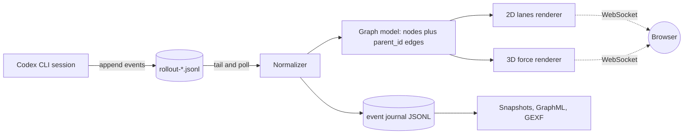
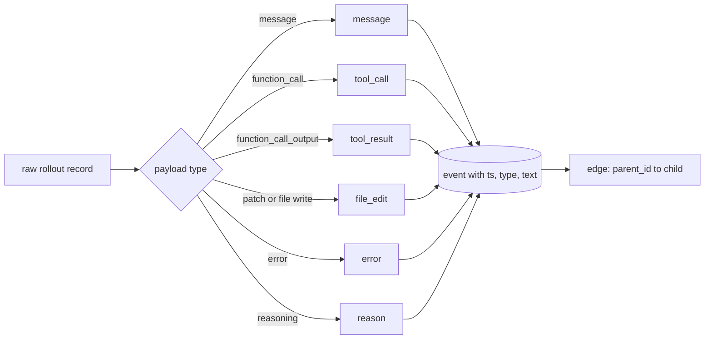
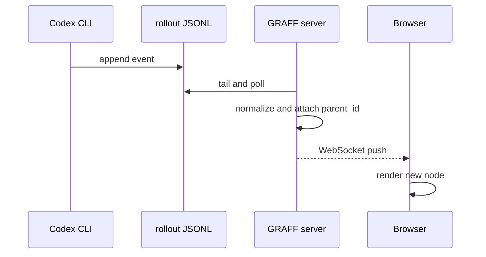

# I built a lineage graph for my AI coding agent

I spend my days around data pipelines: sources, transformations, lineage, DAGs, freshness checks, observability. Last week it hit me that I run a pipeline several times a day and never look inside it. It is called a coding agent.

Every session it reads files, runs commands, edits code and throws errors. Then it says "done" and I trust it. That felt wrong, so I built GRAFF: a live graph of everything my agent does, in real time.

## An agent is a pipeline. Treat its log as a source.

The most useful discovery was that nothing had to be invented. Codex already writes its own history to disk, one append-only file per session:

```
~/.codex/sessions/<YYYY>/<MM>/<DD>/rollout-*.jsonl
```

That is a CDC source with a bonus: no schema migration, no connector, just a file that grows while the agent works. So the whole architecture fits on one slide.




## Normalize first, render later

Raw records are a mess: session metadata, world state, turn context, token counters, messages, function calls and their outputs. Mixing that with rendering code is how side projects die. So there is one small intermediate schema, and everything downstream reads only it:

`{ ts, actor, type, text, parent_id }`

Types: `reason`, `message`, `tool_call`, `tool_result`, `file_edit`, `error`. The `parent_id` field is the whole trick. Once each event points to the event that caused it, the DAG builds itself, and a branching turn (one thought, five tool calls, five results) is visible instead of hidden.




## Two views, because one is never enough

The same graph, two very different jobs.

**2D lanes.** Horizontal axis is time, vertical axis is event type. Each event sits on its own lane, arrows cross between lanes. It reads like a sequence diagram of the run: you instantly see when the agent was reasoning, when it went to the terminal, and where an error threw it back. This is the view I actually work in.

**3D "neuron brain".** The same nodes in three dimensions, with a color gradient over time: cold blue at the start of the session, warm orange at the end. Slowly rotating. It is not the most precise view, and it is the one that makes a long chain legible as a shape: you can see the agent spiral, or branch, or grind in one place. Green triangle marks the start, yellow marks the end.

## Real time and, importantly, saving

The server tails the rollout file and pushes new nodes over a WebSocket, so the graph grows while the agent is still typing. As for saving: a screenshot is not a chain. Each run writes an event journal (JSONL) plus a graph snapshot (JSON, GraphML, GEXF), so a session can be reopened, replayed and exported into Gephi later.




## What actually broke

This is the part I would have wanted to read before starting. Everything below happened on real sessions.

| Symptom | Actual cause | Fix | Numbers |
|---|---|---|---|
| Graph opens empty | "latest session" was the newest file, which was a 27 line session with no tool calls | Choose the newest session that has content | 1 node to 403 nodes |
| Library refused to load | Windows registry maps `.js` to `text/plain`, and Python's mimetypes honors it, so scripts were served as plain text | Own MIME table, `no-store`, `nosniff`, versioned URLs | page worked, library did not |
| Error overlay covered the graph, always | Our own CSS `display: grid` overrode the `hidden` attribute | `[hidden] { display: none !important; }` | the graph was working all along |
| "Your fix did nothing" | An old server process kept serving the previous static files from memory | Restart the process, not just edit the file | 20 minutes of confusion |
| 3D became unusable at scale | Every edge was drawn as its own object, every node as its own mesh | Lines for edges, instancing for nodes | 11 381 to 2 951 draw calls, about 7.8x less CPU per frame |
| CPU 67 percent, GPU 28 percent | Too many objects, not too many pixels | Same as above | the idle GPU was the clue |
| A 12.5 MB session took 57 seconds to open | A loop that re-split the buffer on every append, so parsing was quadratic | One split per chunk | 57.7 s to 0.56 s |

## What I would tell another data engineer

1. **Freshness is not usefulness.** The newest file in a folder is not automatically the right input. The empty graph bug was a data selection bug, and it looked exactly like a frontend bug.
2. **When a GPU is idle and the CPU is busy, count your objects.** Draw calls, rows, HTTP requests, whatever. The bottleneck was never the renderer, it was the number of things handed to it.
3. **A shim is a contract.** I patched a missing `Timer` class from a newer version of a 3D library. The library chained `update().getDelta()`, and my version returned nothing, so the whole thing died. Mirror the API exactly, including return values.
4. **Normalize at the edge.** One small event schema made the parser, the two renderers, the journal, the exports and the AI enrichment mode independent of each other. Every time I was tempted to read raw records somewhere downstream, I regretted it.
5. **Save structures, not screenshots.** A JSONL journal plus a snapshot turned a visual toy into something I can diff, replay and query.

The project is small: a parser, a socket, two renderers and a lot of deleted code. But I now watch my agent work the same way I watch a pipeline run, and I catch wrong turns in seconds instead of reviewing them in a diff an hour later.

If you work with data, you already have all the instincts needed to build something like this. The agent is just another pipeline. Go look inside it.
