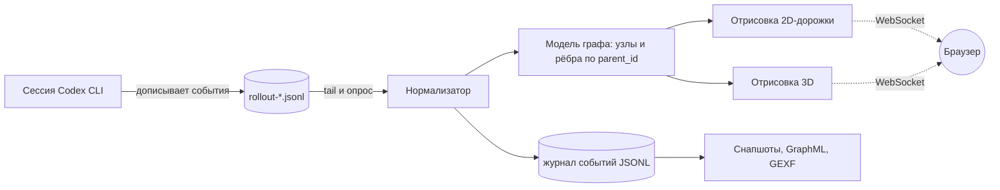
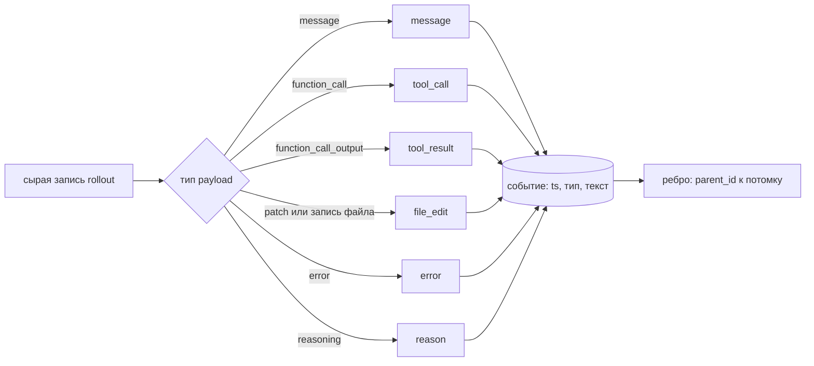
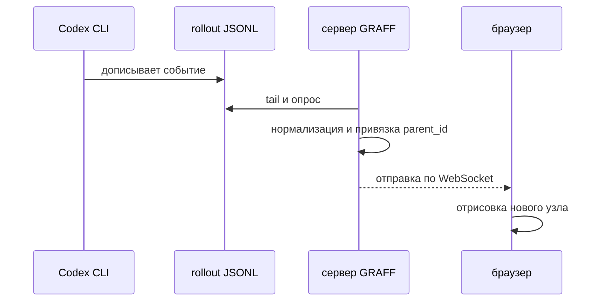

# Я построил граф происхождения данных для своего ИИ-агента

Я работаю с данными: источники, преобразования, lineage, DAG-и, проверки свежести, observability. На прошлой неделе меня накрыла простая мысль: я запускаю конвейер по несколько раз в день и ни разу не заглядывал внутрь него. Этот конвейер называется «агент, который пишет код».

За сессию он читает файлы, выполняет команды, правит код и падает с ошибками. Потом говорит «готово», и я ему верю. Мне это не понравилось, и я построил GRAFF: живой граф всего, что делает агент, в реальном времени.

## Агент это конвейер. Его лог это источник.

Самое полезное открытие: изобретать ничего не нужно. Codex уже пишет свою историю на диск, по одному дописываемому файлу на сессию:

```
~/.codex/sessions/<ГГГГ>/<ММ>/<ДД>/rollout-*.jsonl
```

Это источник в духе CDC, только приятнее: не нужны ни коннектор, ни миграции схем, есть файл, который растёт, пока агент работает. Поэтому вся архитектура укладывается в одну схему.




## Сначала нормализация, отрисовка потом

Сырые записи это каша: метаданные сессии, состояние мира, контекст хода, счётчики токенов, сообщения, вызовы инструментов и их вывод. Смешивать это с кодом отрисовки это верный способ похоронить пет-проект. Поэтому есть одна маленькая промежуточная схема, и всё дальше читает только её:

`{ ts, actor, type, text, parent_id }`

Типы: `reason`, `message`, `tool_call`, `tool_result`, `file_edit`, `error`. Поле `parent_id` и есть весь фокус. Как только каждое событие ссылается на то, что его вызвало, DAG строится сам, и ветвление (одна мысль, пять вызовов, пять результатов) становится видимым, а не спрятанным.




## Два вида, потому что одного всегда мало

Один и тот же граф, две очень разные задачи.

**2D-дорожки.** По горизонтали время, по вертикали тип события. Каждое событие стоит на своей дорожке, стрелки идут между дорожками. Читается как диаграмма последовательности: сразу видно, где агент рассуждал, где ушёл в терминал и где ошибка отбросила его назад. В этом виде я и работаю.

**3D «нейронный мозг».** Те же узлы в трёх измерениях с градиентом по времени: холодный синий в начале сессии, тёплый оранжевый в конце. Медленно вращается. Это не самый точный вид, зато именно он показывает длинную цепочку как форму: видно, как агент закручивается спиралью, ветвится или топчется на одном месте. Зелёный треугольник отмечает начало, жёлтый конец.

## Реальное время и, что важнее, сохранение

Сервер следит за файлом роллаута и отправляет новые узлы по WebSocket, поэтому граф растёт, пока агент ещё печатает. Про сохранение: скриншот это не цепочка. Каждый запуск пишет журнал событий (JSONL) и снапшот графа (JSON, GraphML, GEXF), так что сессию можно открыть заново, проиграть и выгрузить в Gephi.




## Что реально ломалось

Это та часть, которую мне хотелось бы прочитать до начала. Всё ниже случилось на настоящих сессиях.

| Симптом | Настоящая причина | Что сделал | Числа |
|---|---|---|---|
| Граф открывается пустым | «Последняя сессия» оказывалась самым свежим файлом, а это была сессия на 27 строк без вызовов инструментов | Выбирать самую свежую сессию, в которой есть содержимое | было 1 узел, стало 403 |
| Библиотека не загружалась | В реестре Windows расширение `.js` связано с `text/plain`, Python это честно повторяет, и скрипты уходили как обычный текст | Своя таблица MIME, `no-store`, `nosniff`, версия в адресе | страница работала, библиотека нет |
| Плашка ошибки всегда закрывала граф | Наш же CSS `display: grid` перебивал атрибут `hidden` | `[hidden] { display: none !important; }` | граф работал всё это время |
| «Твоя правка ничего не изменила» | Старый процесс сервера держал в памяти прежнюю раздачу статики | Перезапускать процесс, а не только править файл | двадцать минут недоумения |
| 3D стал невыносимым на больших графах | Каждое ребро рисовалось своим объектом, каждый узел своим мешем | Линии для рёбер, инстансинг для узлов | 11 381 стало 2 951 draw call, процессора на кадр меньше примерно в 7,8 раза |
| Процессор 67 процентов, GPU 28 | Слишком много объектов, а не пикселей | То же самое | простаивающий GPU и был подсказкой |
| Сессия 12,5 МБ открывалась 57 секунд | Цикл заново разбивал буфер на каждой вставке, то есть парсинг был квадратичным | Одно разбиение на порцию | 57,7 с стало 0,56 с |

## Что я скажу коллеге по данным

1. **Свежесть не равна полезности.** Самый новый файл в папке не обязательно правильный вход. Баг с пустым графом был багом выбора данных, а выглядел как баг фронтенда.
2. **Если GPU простаивает, а CPU занят, считайте объекты.** Draw calls, строки, HTTP-запросы, что угодно. Узкое место было не в рендере, а в количестве того, что ему отдали.
3. **Шим это контракт.** Я подменил отсутствующий класс `Timer` из более новой версии 3D-библиотеки. Библиотека вызывала цепочку `update().getDelta()`, а моя версия не возвращала ничего, поэтому всё падало. Повторяйте API точно, включая возвращаемые значения.
4. **Нормализуйте на входе.** Одна маленькая схема событий развязала парсер, две отрисовки, журнал, экспорты и ИИ-режим. Каждый раз, когда хотелось прочитать сырые записи где-то дальше по потоку, я об этом жалел.
5. **Сохраняйте структуры, а не скриншоты.** Журнал JSONL плюс снапшот превратили визуальную игрушку в то, что можно сравнить, проиграть и опросить.

Проект небольшой: парсер, сокет, две отрисовки и много удалённого кода. Зато теперь я смотрю за агентом так же, как смотрю за конвейером данных, и замечаю неверный поворот за секунды, а не при разборе диффа через час.

Если вы работаете с данными, у вас уже есть все нужные рефлексы, чтобы сделать похожее. Агент это просто ещё один конвейер. Загляните внутрь.
